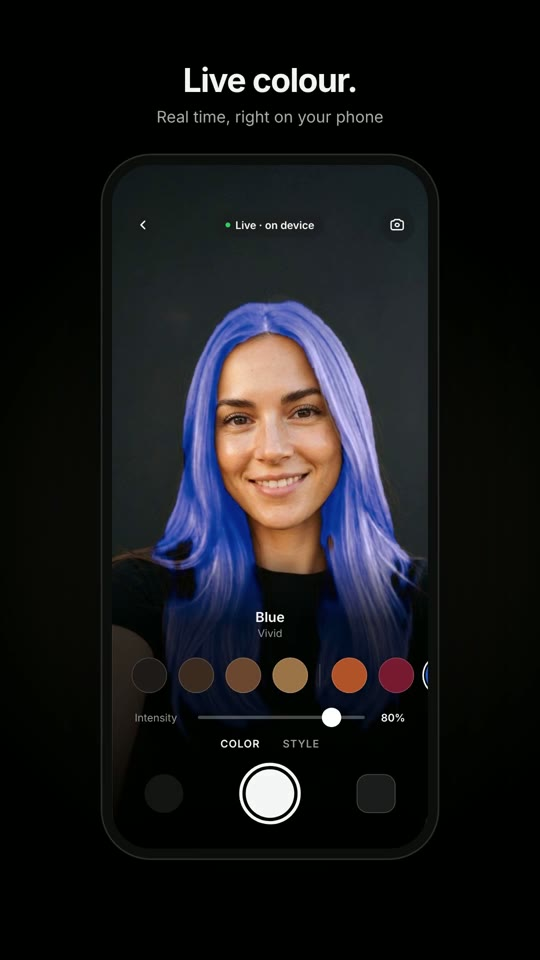
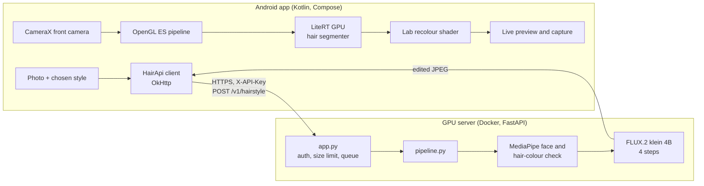

Uploading hair_tryon_ad.mp4…

# Hair Try-On

See a new hair colour or hairstyle on your own photo before going to the salon.

[](docs/media/hair_tryon_ad.mp4)

*Click the image to play the 21-second demo video.*

Two features, one Android app:

| Feature | Where it runs | What it does |
| --- | --- | --- |
| **Live colour** | On the phone, real time | Front camera in, recoloured hair out at ~30 FPS. Hair segmentation on the GPU (LiteRT), recolouring in a GLSL shader. No network needed, no photo leaves the phone. |
| **AI hairstyle** | Your own GPU server | Take a photo, pick one of 16 styles, get the photo back with the new cut in about 4 seconds of server time. FLUX.2 [klein] 4B edits the photo from a text prompt and keeps the person's own hair colour. |

## How it works



The live-colour path never talks to the server. The hairstyle path sends one photo and one style id, and gets one JPEG back.
Full flow diagrams, timings and error handling are in **[docs/ARCHITECTURE.md](docs/ARCHITECTURE.md)**.

## Repository layout

| Path | What is in it |
| --- | --- |
| `android/hairtryon/` | The app: camera, GL pipeline, segmentation, recolour shader, Compose UI, hairstyle client |
| `android/litert-bench/` | Small benchmark app used to compare LiteRT CPU/GPU on real devices |
| `server/hairapi/` | The hairstyle API (FastAPI + FLUX.2 klein), its `catalog.json` of styles and prompts, and a Dockerfile |
| `server/common/`, `server/hairfast/`, `server/hairclipv2/`, `server/qwen/`, `server/stable_hair/`, `server/flux2/` | Runners used to compare other hairstyle models (research only, see licences below) |
| `src/vto_spike/` | Python reference implementation of the recolouring and segmentation, the ground truth for the on-device shader |
| `scripts/` | Model download, test photo prep, golden tests against a phone, benchmarks, server helper (`hairstyle_sync.py`) |
| `tests/` | pytest tests for the recolour reference |
| `results/phase0_report.md`, `results/fps/` | Feasibility study and on-device FPS logs |
| `docs/` | Architecture and the demo video |

## Measured performance

| Item | Result |
| --- | --- |
| Hair model on Galaxy S20, LiteRT GPU FP16 | 6.9 ms end to end (CPU: 22.5 ms) |
| Whole app on Galaxy S20 | 30 FPS render, mask about one camera frame behind (33-45 ms) |
| 5-minute soak on S20 | Steady 30 FPS, battery +3 C, no throttling (plugged in) |
| Hairstyle API, one RTX 3090 | about 4.3 s per image, about 8.4 GB VRAM, one request at a time (about 800 images/hour/GPU) |

MediaPipe Tasks' GPU delegate crashed on both test devices; calling LiteRT's `CompiledModel` directly on the GPU works, which is what the app does.

## Quick start

### 1. Python reference and models

```bash
conda env create -f environment.yml        # environment name: vto
conda activate vto
python scripts/download_models.py          # MediaPipe .tflite files into models/
pytest
```

### 2. Android app

Needs Android Studio (JDK 17+) and a phone with Android 8.0+ (tested on a Galaxy S20). Live colour needs no server.

```bash
cd android/hairtryon
./gradlew assembleDebug                    # gradlew.bat on Windows
adb install -r app/build/outputs/apk/debug/app-debug.apk
```

To enable the hairstyle feature, create `android/hairtryon/local.properties` (git-ignored):

```properties
hairapi.url=https://your-server.example.com
hairapi.key=the-key-you-set-as-API_KEY-on-the-server
```

> **The key is compiled into the APK.** Treat it as a staging key, rotate it, and put real per-user authentication in front of the API
> before any public release.

### 3. Hairstyle server

Needs a Linux machine with an NVIDIA GPU (about 16 GB VRAM free is comfortable, 8.4 GB is used) and Docker.
Details, API reference and error codes: [server/hairapi/README.md](server/hairapi/README.md).

```bash
# the image's build context holds server/*, vto_spike/ and models/ side by side
mkdir build && cp -r server/* build/ && cp -r src/vto_spike build/vto_spike && cp -r models build/models
docker build -f build/hairapi/Dockerfile -t vto-hair-api build

# FLUX weights are not in the image: download once, then mount read-only (the container runs offline)
HF_HOME="$PWD/hf-cache" huggingface-cli download black-forest-labs/FLUX.2-klein-4B

export API_KEY="$(head -c 32 /dev/urandom | od -An -tx1 | tr -d ' \n')"   # keep this: the app needs the same value
docker run -d --name vto-hairapi --gpus all -p 127.0.0.1:8090:8090 \
  -e API_KEY -e MAX_QUEUE=12 -v "$PWD/hf-cache:/hf:ro" vto-hair-api
curl http://127.0.0.1:8090/healthz     # 503 while loading (about 1.5 minutes), 200 when ready
```

`scripts/hairstyle_sync.py` (`scripts\hs` on Windows) automates build/push/run on a remote server over SSH. It needs `VTO_HOST` (ssh host or alias) and
`VTO_SRV_ROOT` (project folder on that server) set in your environment. Put the API behind HTTPS (Cloudflare Tunnel, Tailscale Funnel or a reverse proxy) before
pointing a phone at it.

## Privacy

The hairstyle server keeps photos and results in memory for the length of one request. Nothing is written to disk, and logs hold only the style id, timings and a
hair-colour category. If you run this for other people you still need your own consent text, retention policy and a check against local biometric and
privacy law.

## Known limits

- The hairstyle result is a re-draw of the whole image. The face and background can drift slightly and skin gets smoothed.
- The person's hair colour is mapped to one of five colour words, so it is a close match, not an exact one.
- Hair segmentation fails on hats, bald heads, white beards and very small subjects.
- Live colour is tuned on one device family (Galaxy S20). Tablets and landscape rotation are untested.

## Licences and third-party material

This project's code is under the [Apache License 2.0](LICENSE). Models, fonts and datasets keep their own terms; see [NOTICE](NOTICE).

| Asset | Licence | Notes |
| --- | --- | --- |
| MediaPipe hair segmenter, selfie multiclass | Apache-2.0 | Downloaded by `scripts/download_models.py`, not committed |
| FLUX.2 [klein] 4B | Apache-2.0 | Used by the hairstyle API. Its text encoder is Qwen3; check the licence in the model repo before commercial use |
| Inter font | SIL OFL 1.1 | Bundled in the app |
| FLUX.2 [klein] 9B | FLUX Non-Commercial | Comparison runner only, not used by the API |
| HairFast | Code MIT, weights partly non-commercial | Comparison runner only |
| HairCLIPv2 | No licence file (all rights reserved) | Comparison runner only, not redistributed here |
| Stable-Hair | Code Apache-2.0, SD 1.5 CreativeML OpenRAIL-M | Comparison runner only |
| Qwen-Image-Edit | Apache-2.0 | Comparison runner only |

**Not included:** the datasets used in the feasibility study (a Kaggle face dataset, whose terms forbid redistribution, and Wikimedia Commons photos listed with
their licences in `data/manifest_wiki.csv`), and any personal test photos. The scripts expect you to supply your own under `data/`.
