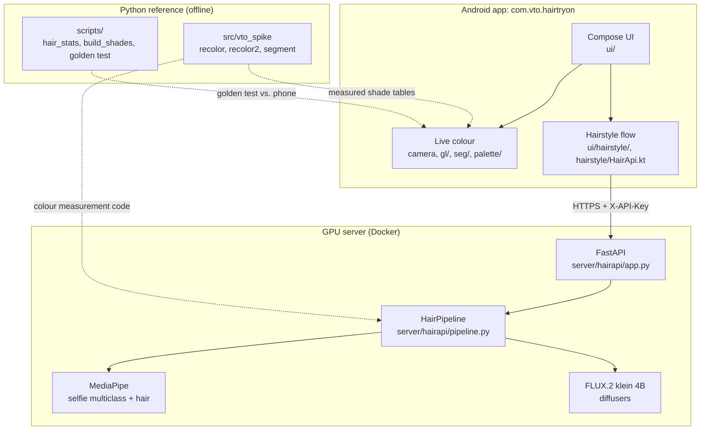
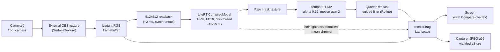
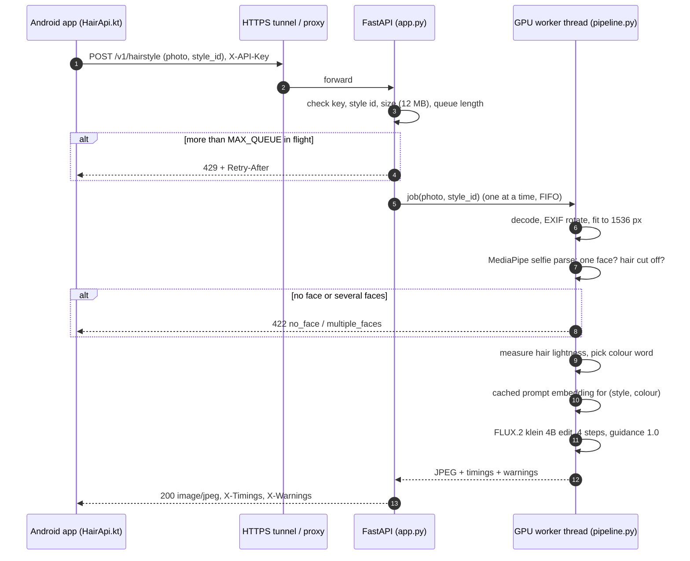
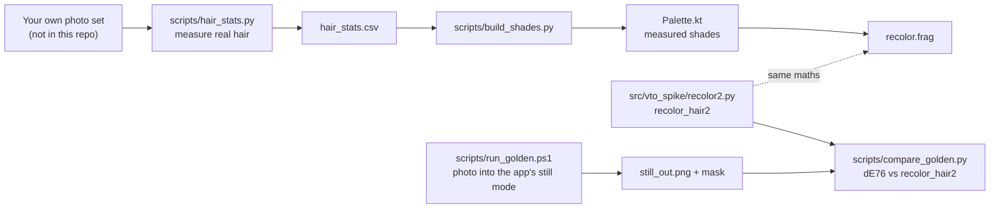

# Architecture

Hair Try-On has two independent paths. They share one design idea: **measure the person's own hair, and keep it as the reference**, so the result looks like
the same person with a different colour or cut, not a different person.

| | Live colour | AI hairstyle |
| --- | --- | --- |
| Runs on | the phone | a GPU server you host |
| Network | none | one HTTPS request per try |
| Input | camera frames, 30 per second | one photo + one style id |
| Output | the same frames, hair recoloured | one JPEG of the photo with the new cut |
| Latency | one camera frame (about 33-45 ms) | about 4.3 s on the server, about 11 s end to end through a relayed tunnel |

## 1. System overview

## 2. Live colour (on device)

Everything stays on the GPU: the camera frame is never copied to the CPU except for a small 512x512 readback the model needs.

**Why these choices**

- **LiteRT `CompiledModel` directly, not MediaPipe Tasks.** The MediaPipe GPU delegate aborted on both test devices; the direct LiteRT GPU FP16 path ran the hair model
  in about 7 ms. The readback is synchronous so the mask always belongs to the frame on screen.
- **Mask smoothing.** The model's mask flickers at hair edges. A motion-adaptive exponential moving average (alpha 0.12, gain 3) cut edge flicker from 0.0349 to 0.0078
  at almost no loss in tracking (IoU 0.964 vs 0.969). The guided filter is quarter resolution because the first half-resolution version cost 10 ms per frame.
- **Recolouring in Lab, with measured shades.** The shader (`recolor.frag`, shared helpers in `lab.glsl`) maps the person's own hair lightness quantiles onto
  real-hair tonal distributions for the chosen shade, with per-shade colour ramps and an edge falloff that avoids halos. The segmenter measures the person's quantiles
  on every 4th mask (hair lightness changes slowly), and the shader eases toward the latest measurement. Until the first measurement it uses an identity map so the frame stays natural.
- **Orientation.** The `SurfaceTexture` matrix already contains the sensor rotation. The app must not rotate again by CameraX's `rotationDegrees`.

Key files: `gl/CameraRenderer.kt` (frame loop), `seg/LiteRtSegmenter.kt`, `palette/Palette.kt`, `palette/ColorMath.kt`, `assets/shaders/*.frag`.

## 3. AI hairstyle (server)

**Request handling.** `app.py` authenticates with a constant-time key comparison, validates the style id and the upload size, and counts requests in flight. GPU work runs on
a single worker thread (the pipeline and its CUDA/MediaPipe state live on it), so requests are served one at a time in arrival order. When more than `MAX_QUEUE` requests are
waiting, new ones get `429`, so the longest wait stays below the client's 100 s read timeout and a proxy's request limit.

**The edit.** `pipeline.py` builds one fixed prompt per style from `catalog.json`:

> Change only the hairstyle of the person in the photo to {hair}, in {colour} hair colour. Keep the face, skin texture, expression, clothes, pose, lighting and background exactly the same. Photorealistic.

The colour word (black, dark brown, brown, light brown, blonde) comes from the person's measured hair lightness, using the same measurement code as the on-device path
(`vto_spike.recolor2`). Naming the colour fixed a failure where "keep the current colour" gave black hair blond highlights. All prompt embeddings are computed once at
startup (style x colour), then the text encoder is unloaded, which keeps VRAM at about 8.4 GB.

**Errors the app understands** (`hairstyle/HairApi.kt` maps them to screens):

| Server | App | Meaning |
| --- | --- | --- |
| 422 `no_face` | NoFace | retake with the whole head in frame |
| 422 `multiple_faces` | MultipleFaces | only the person to restyle |
| 400 `bad_image`, 413 | BadImage | not an image, or over 12 MB |
| 429, 503 | Busy | queue full or model still loading, try again |
| 401, 5xx, unknown style | Offline | not fixable by the user (wrong key, server down) |

`X-Warnings: head_cut_off` is only a warning: hair touches the top edge, the result is still returned.

**Privacy by construction.** Photos and results exist in memory for the length of a request. Nothing is written to disk and logs hold the style id, timings and the colour word.

**Other modes kept for comparison.** `REF_MODE=ref` (a reference photo of the style as a second image) and `COMPOSITE=1` (paste the hair back onto the original photo)
are still in the code. Both were worse for this use: the reference photo leaks its own framing and colour, and the paste-back leaves pale patches on the forehead.
`server/hairfast`, `hairclipv2`, `qwen`, `stable_hair` and `flux2` are runners for the model comparison that led to this choice.

## 4. Python reference and the golden test

The shader is a port of a Python reference, and the reference is the ground truth for how the recolour should look.

- `scripts/run_golden.ps1` pushes a photo to a connected phone, renders it with Refine off, and pulls the result and the exact mask the shader used.
- `scripts/compare_golden.py` runs the Python recolour on the same photo and mask and checks the colour difference. Port fidelity only, not realism.
  Tolerances: hair mean dE 1.0, p99 6.0, background 1.5.
- `ColorMathTest.kt` unit-tests the Lab maths against OpenCV.

## 5. Where to look

| I want to... | Start here |
| --- | --- |
| change the live recolour look | `android/hairtryon/.../palette/Palette.kt`, `assets/shaders/recolor.frag`, `src/vto_spike/recolor2.py` |
| change mask stability | `gl/CameraRenderer.kt` (EMA, guided filter), `assets/shaders/mask_ema.frag`, `gf_*.frag` |
| add or edit a hairstyle | `server/hairapi/catalog.json` (id, gender, length, name, `hair_prompt`), plus a tile image in the app's resources |
| change the API | `server/hairapi/app.py`, `pipeline.py`, and the client `hairstyle/HairApi.kt` |
| measure performance on a device | `android/litert-bench/`, `scripts/run_litert_bench.ps1`, `scripts/run_soak.ps1` |
